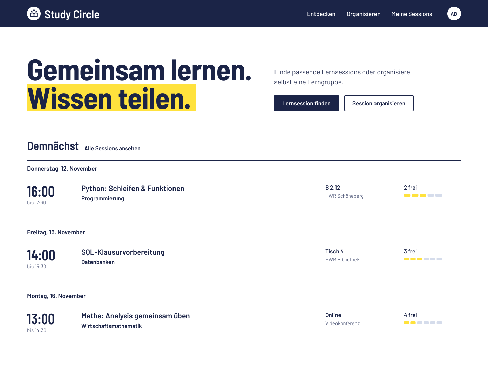
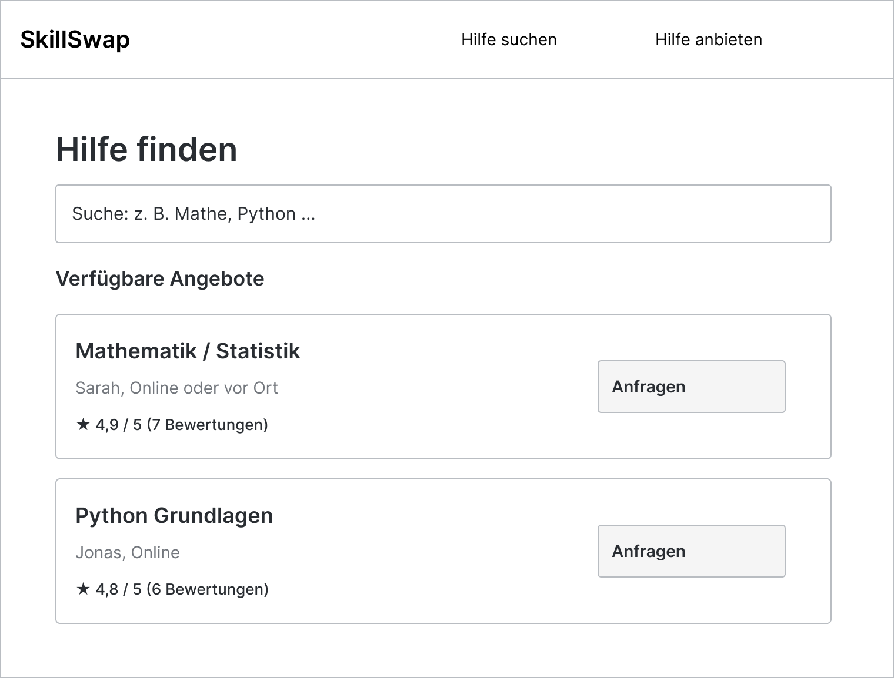
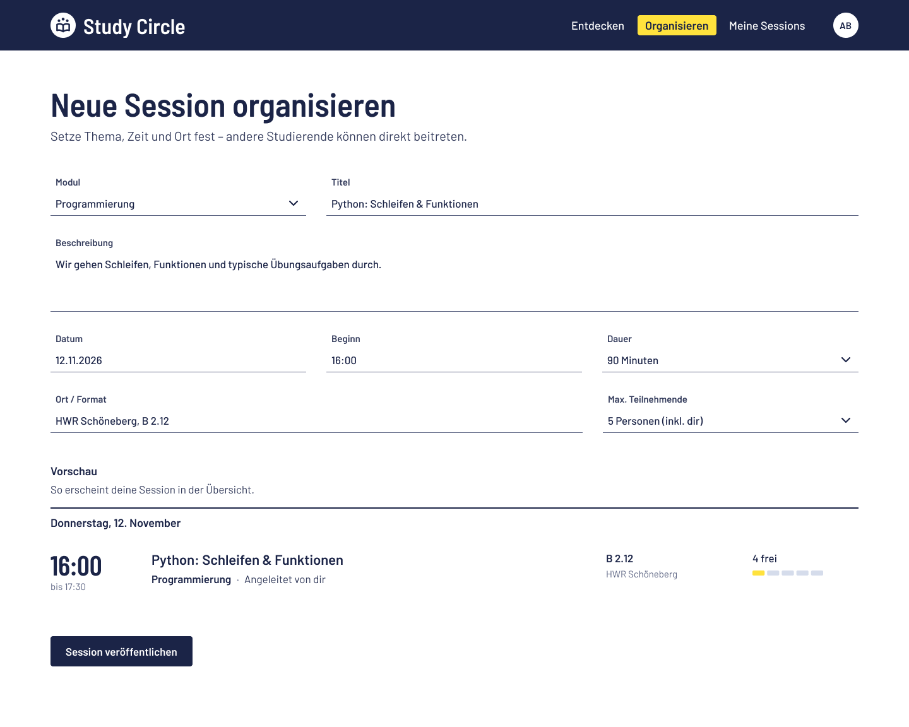
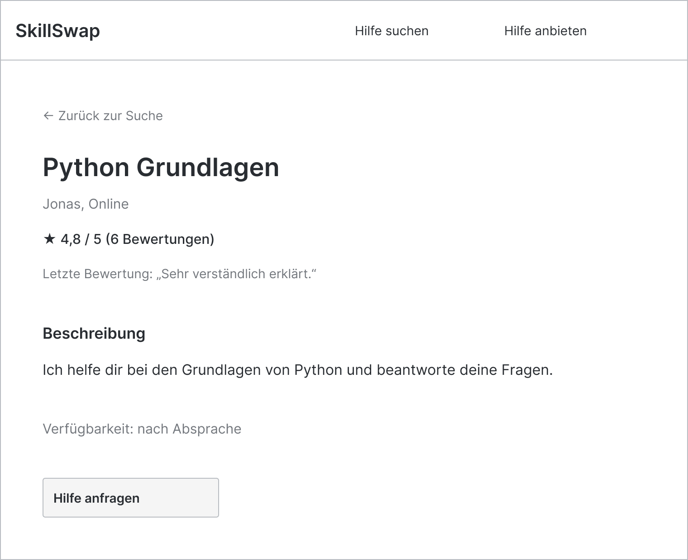
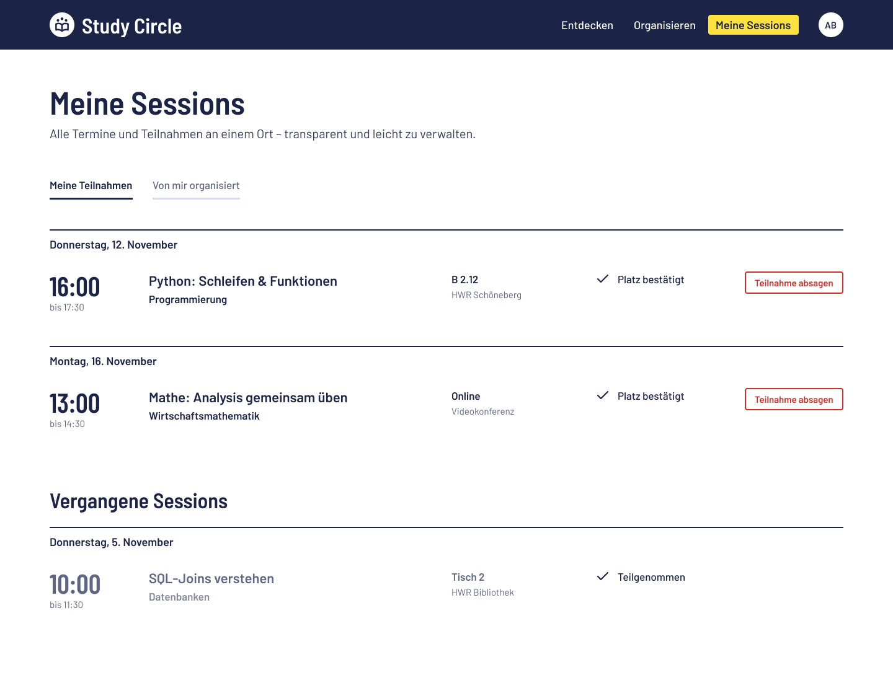

# Value Proposition

## Target Users and Their Problems

Ziel sind Studierende und gegebenenfalls Schüler in Deutschland, die Unterstützung beim Lernen oder beim Erwerb neuer Fähigkeiten benötigen. Auf der anderen Seite dieselbe Zielgruppe, welche Hilfe anbieten möchte.

### Demand Side: [User Group]

[Describe (a) who these users are (e.g., as persona) and (b) which problem or unmet need brings them to your platform. Be specific and grounded in reality with both the user and the problem description.]

Persona Johannes (22 Jahre alt):
- Student Wirtschaftsinformatik 4. Semester, HWR Berlin
- Hat Python in mehreren Modulen und versteht die Grundlagen nicht
- Bezahlte Privatnachhilfe kann er sich nicht leisten
- Durch seinen Teilzeitjob gelingt es ihm nicht jede Vorlesung zu besuchen
- Seine Kommilitonen im Kurs können ihm nicht helfen
- Hat gute Kenntnisse im wirtschaftlichen Arbeiten

### Supply Side: [User Group]

[Describe who these users are, what they have to offer, and which problem or need motivates them to participate. Again, be specific and grounded in reality.]

Persona Sarah (25):
- Studentin Wirtschaftsinformatik 7. Semester, HWR Berlin
- Sie bringt Studiumsinhalte gerne näher, um den Stoff selbst zu verfestigen
- 

## Our Platform Solution

[Briefly describe the purpose of your platform. What brings the two user groups together? What is being offered, requested, or exchanged?]

### Solution for the Demand Side

[Explain how your application addresses the demand-side users' problem. Why would they choose to use your platform?]

### Solution for the Supply Side

[Explain how your application addresses the supply-side users' problem. Why would they choose to offer their services, products, or resources through your platform?]

## Happy Paths

[Describe how your platform connects the two groups and facilitates their interaction: What steps lead from an offer or request to a successful match or exchange?

Illustrate the typical successful interaction with your platform from both user perspectives, from from the app's entry point to a completed task. You might want to show the path as (schematic) screen flows. Ensure your "happy path" (a) is consistent with the Value Proposition, (b) demonstrates how the two user groups interact through the platform, and (c) shows the features as actually implemented in the submitted web app.]

### Demand-Side Happy Path

[Show the demand-side user "happy path".]

### Supply-Side Happy Path

[Show the supply-side user "happy path".]

---

## Initial Target Scope (as per Assignment)

[Include your visual scoping of the web app (e.g., UI screens scribbles), as elaborated for your Assignment at start of the project.]
### 01 Startseite

### 02 Hilfe suchen

### 03 Hilfe anbieten

### 04 Angebotsdetails

### 05 Meine Anfragen

