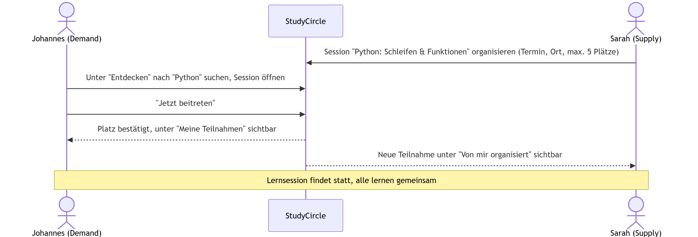
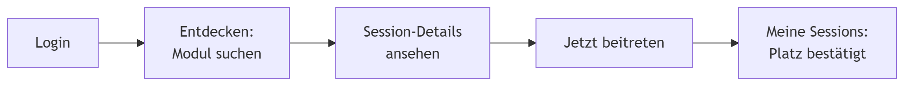
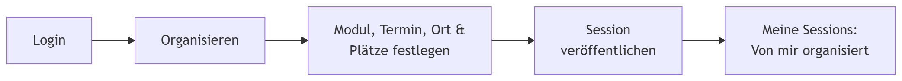
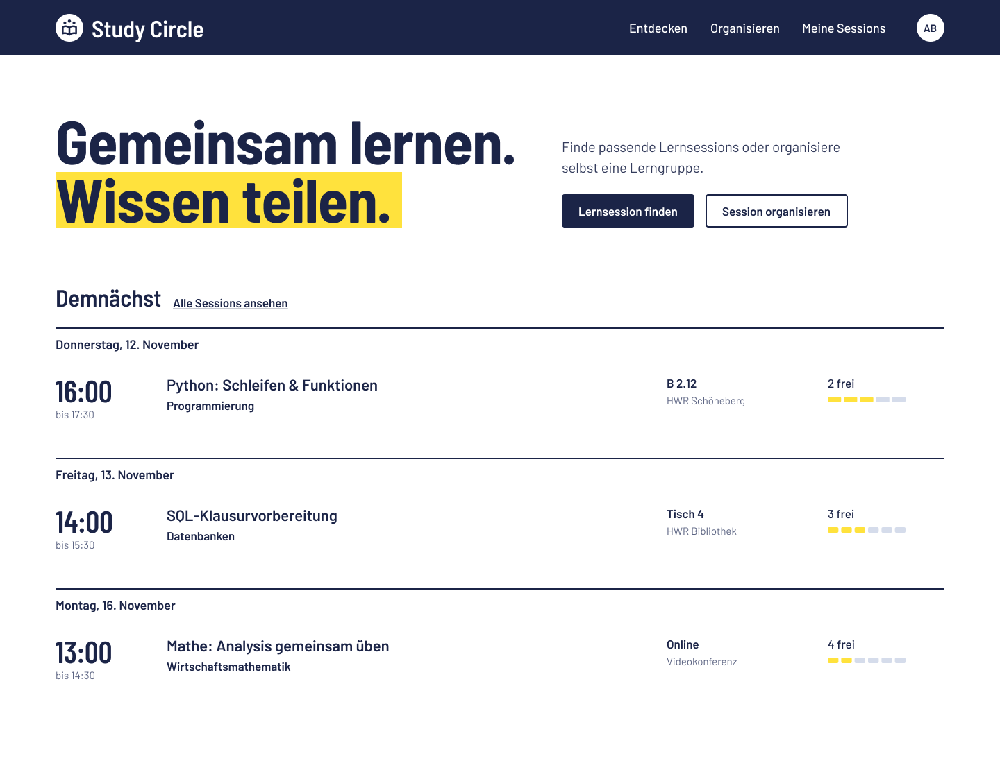
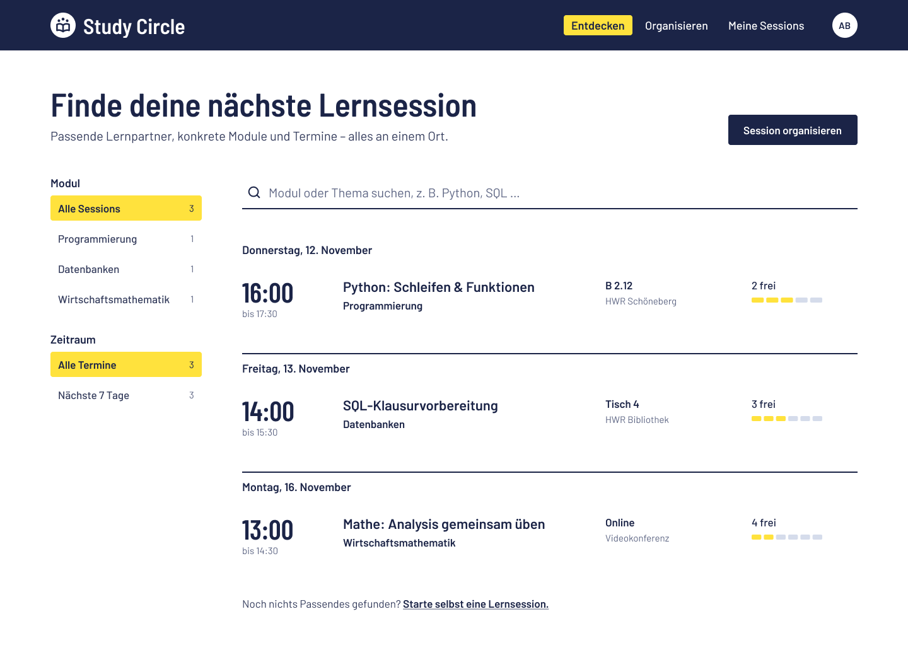
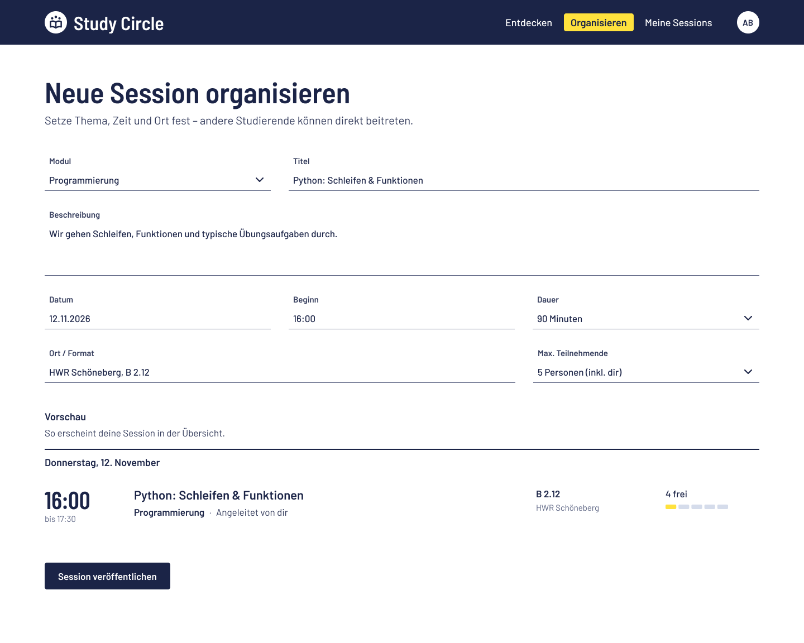
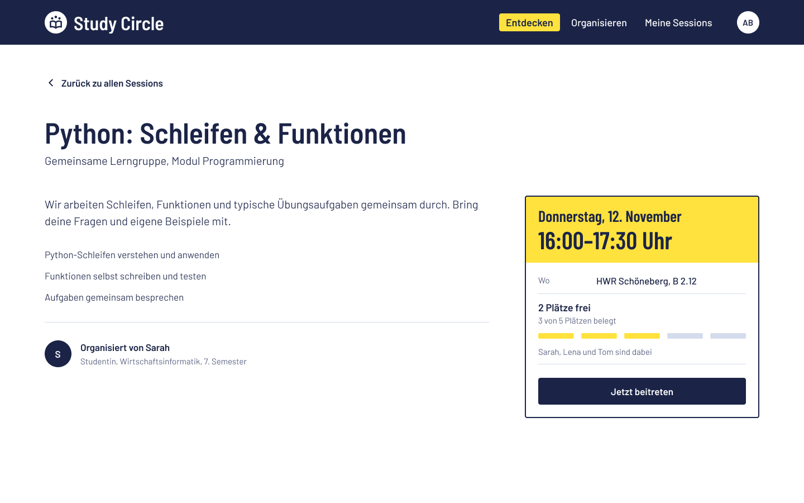
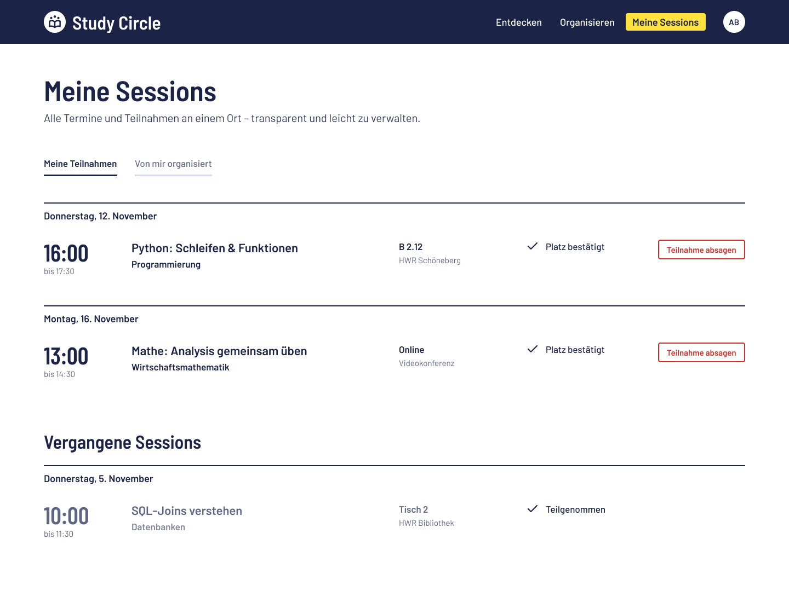

# Value Proposition

## Target Users and Their Problems

StudyCircle richtet sich an Studierende der HWR Berlin, die sich zum gemeinsamen Lernen treffen möchten. Supply und Demand Side sind dabei **dieselbe** Nutzergruppe mit demselben Ziel: **zusammen lernen**. Sie unterscheiden sich nur darin, wer eine Lernsession organisiert und wer ihr beitritt. Die Rollen können jederzeit wechseln.

Unsere Umfrage (54 gültige Antworten, Mehrfachnennungen möglich) zeigt:
- **67 %** würden zur Prüfungsvorbereitung und Motivation lieber mit Kommilitonen lernen als nur mit KI.
- **31 %** nennen die zeitliche Abstimmung als Hindernis, andere um Hilfe zu bitten.
- **28 %** kennen niemanden, der ihnen beim Lernen helfen könnte.

Fast alle Befragten (98 %) nutzen KI, und 63 % finden sie schneller als andere zu fragen. StudyCircle ersetzt KI daher nicht, sondern setzt dort an, wo sie nicht reicht: beim gemeinsamen Üben und bei der Motivation.

### Demand Side: Teilnehmende

**Persona Johannes (23 Jahre alt)**
- Student Wirtschaftsinformatik im 3. Semester
- Bereitet sich auf die Programmierung-Klausur vor
- Lernt meistens alleine mit KI und verliert dabei die Motivation
- Kennt in seinem Kurs kaum jemanden zum Lernen
- Hat durch seinen Teilzeitjob wenig Zeit für Terminabsprachen

**Problem:** Johannes möchte einer Lerngruppe beitreten, findet aber keine. WhatsApp-Gruppen erreichen nur andere Kurse, und in seinem organisiert selten jemand ein Treffen.

### Supply Side: Organisierende

**Persona Sarah (22 Jahre alt)**
- Studentin BWL im 3. Semester
- Belegt dasselbe Statistik-Modul wie Johannes
- Lernt besser mit festen Terminen und anderen Leuten
- Ihre alte Lerngruppe hat sich aufgelöst
- Plant gern selbst, wenn sie weiß, dass andere mitmachen

**Problem:** Sarah würde eine Lernsession organisieren, weiß aber nicht, wen sie außerhalb ihres Kurses erreichen kann. Ihre Motivation ist Eigeninteresse: Sie will selbst die Klausur bestehen.

## Our Platform Solution

**StudyCircle ist eine Plattform, auf der Studierende Lernsessions organisieren, finden und ihnen direkt beitreten können, vorallem über den eigenen Kurs hinaus.**

Wer eine Session organisiert, legt Modul, Titel, Beschreibung, Termin, Ort und maximale Teilnehmerzahl fest. Andere treten direkt bei, ohne Anfrage und ohne Terminabstimmung. Alle lernen auf eigenem Niveau, niemand muss Experte sein.

Im Unterschied zu WhatsApp-Gruppen oder Tutorien sind die  Lernsessions von StudyCircle **Modulen zugeordnet** und gehen **über den eigenen Kurs hinaus**.

### Solution for the Demand Side

- **Finden:** Sessions nach Modul oder Thema suchen und filtern.
- **Beitreten:** Termin, Ort und freie Plätze sind sichtbar mit einem Klick.
- **Selbst starten:** Findet man nichts Passendes, kann man direkt eine eigene Session organisieren.

### Solution for the Supply Side

- **Mitlernende erreichen:** Eine Session ist für alle angemeldeten Studierende sichtbar.
- **Selbst bestimmen:** Thema, Termin, Ort und Gruppengröße festlegen.
- **Weniger Abstimmung:** Interessierte treten direkt bei, ohne Nachrichten oder Anfragen.

## Happy Paths

Sarah organisiert eine Lernsession mit festem Termin. Johannes findet sie unter „Entdecken“ und tritt direkt bei. Beide sehen die Session unter „Meine Sessions“ und lernen gemeinsam.

### Demand-Side Happy Path

1. **Login:** Johannes meldet sich mit seiner Hochschul-Mailadresse an.
2. **Entdecken:** Er sucht nach „Statistik“ und findet Sarahs Session „Hypothesentests“.
3. **Session-Details:** Er sieht Beschreibung, Termin, Ort und freie Plätze.
4. **Beitreten:** Mit „Jetzt beitreten“ reserviert er direkt einen Platz.
5. **Meine Sessions:** Die Session erscheint unter „Meine Teilnahmen“, bei Bedarf kann er absagen.
6. **Lernen:** Johannes trifft sich zum Termin mit der Gruppe.

### Supply-Side Happy Path

1. **Login:** Sarah meldet sich mit ihrer Hochschul-Mailadresse an.
2. **Organisieren:** Sie erstellt eine neue Session im Modul Statistik.
3. **Details festlegen:** Sie gibt Titel, Beschreibung, Termin, Ort und maximale Teilnehmerzahl an.
4. **Veröffentlichen:** Die Session ist ab sofort für alle Studierenden des Moduls sichtbar.
5. **Meine Sessions:** Unter „Von mir organisiert“ sieht sie, wer beigetreten ist, und kann die Session bei Bedarf absagen.
6. **Lernen:** Sarah trifft sich zum Termin mit der Gruppe und lernt selbst mit.

---

## Initial Target Scope (as per Assignment)

### 01 Startseite

### 02 Hilfe suchen

### 03 Hilfe anbieten

### 04 Angebotsdetails

### 05 Meine Anfragen
