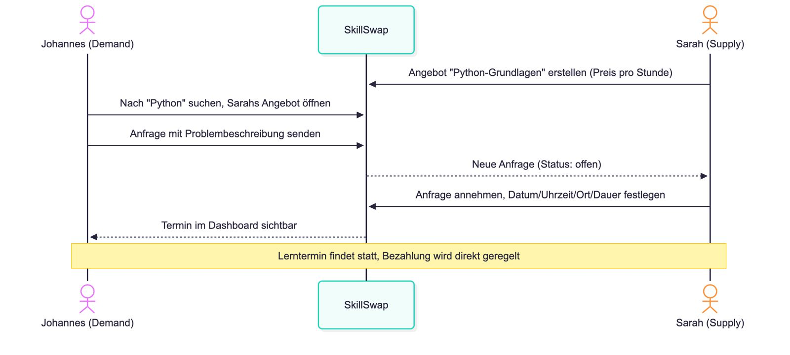
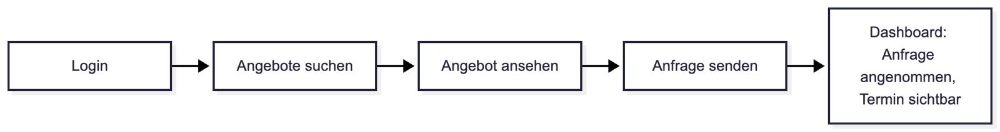
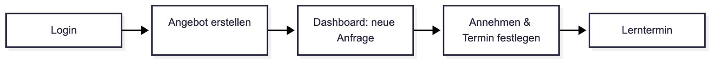

# Value Proposition

## Target Users and Their Problems

Ziel sind Studierende in Deutschland, die Unterstützung beim Lernen oder beim Erwerb neuer Fähigkeiten benötigen. Auf der anderen Seite dieselbe Zielgruppe, welche Hilfe anbieten möchte und dabei die Möglichkeit haben, sich eine kleinigkeit dazu zu verdienen.

### Demand Side: Hilfesuchende Studenten

**Persona Johannes (22 Jahre alt):**
- Student Wirtschaftsinformatik 4. Semester, HWR Berlin
- Hat Python in mehreren Modulen und versteht die Grundlagen nicht
- Bezahlte Privatnachhilfe kann er sich nicht leisten
- Durch seinen Teilzeitjob gelingt es ihm nicht jede Vorlesung zu besuchen
- Seine Kommilitonen im Kurs können ihm nicht helfen

**Das Problem:** Studeneten verstehen nicht alles in der Lehrveranstaltung und müssen oft viel Stoff eigenständig nacharbeiten. Hilfe gibt es oft zwar (Komolitonen, Tutorien, Chatgruppen, KI), ist aber nicht leicht zu finden, hängt vom persönlichen Umfeld ab, passt Zeitlich nicht oder ist nicht Modulspezifisch. Professionelle Hilfe ist für viele Studenten zu teuer.

### Supply Side: Helfende Studenten

**Persona Sarah (25 Jahre alt):**
- Studentin Wirtschaftsinformatik 7. Semester, HWR Berlin
- Sie bringt Studiumsinhalte gerne näher, um den Stoff selbst zu verfestigen
- Sucht nach einer Möglichkeit ihr Engagement ausßerhalb des Studiums zu zeigen
- Sie fände einen kleinen nebenverdienst praktisch, was aber nicht ihre priorität ist

**Problem / Motivation:** Es gibt keine Möglihkeit, einfach, eigenes Wissen sichtbar zu machen und Hilfesuchende außerhalb des eigenen Umfelds zu finden. Sarah möchte Felxibel helfen können und dafür eventuell eine vergütung erhalten. Tutorien sind formal und zeitlich gebunden. Es gibt einige Studenten, die die ehrenamtlich helfen möchten, für einen Nachweis ihres Engagements oder einfach um den Stoff für sich selbst zu festigen.

## Our Platform Solution
**Skillswap** ist eine Web-Plattform indem Studenten Hilfe von anderen Studenten finden, aber auch gleichzeitig ihre Hilfe anbieten können. Helfende können Angebote veröffentlichen, für Kurse oder Themen die sie schon absolviert haben. Hilfesuchende finden diese Angebote, schicken eine Anfrage und vereinbaren dann einen Termin. Ein Student kann beide Seiten annehemn.

Ausgetauscht werden Wissen und Zeit in Form von 1:1 Lernterminen, kostenlos oder gegen einen von den Anbietenden festgelegten Preis. Die Bezahlung wird direkt zwischen den Beteiligten abgesprochen und läuft **nicht** über SkillSwap.

**SkillSwap dient ausdrücklich dem Verstehen von Lerninhalten, nicht dem Bearbeiten von Prüfungsleistungen**. Benotete Abgaben, Hausarbeiten, Projektarbeiten und Prüfungen sind ausgeschlossen. Angebote beziehen sich deshalb auf Module und Themen, nicht auf konkrete Abgaben. Die Registrierung ist nur mit einer Uni-Mailadresse möglich, sodass jede Person nur ein Konto anlegen kann (wird im Prototyp simuliert).

### Solution for the Demand Side

- **Gezielt Hilfe finden:** Angebote lassen sich nach Modul oder Thema suchen und filtern, hochschul- und uniweit statt nur im eigenen Kurs.
- **Modulspezifisch:** Helfende kennen dasselbe Modul an derselben Hochschule, oft mit denselben Dozierenden und Prüfungen. Das kann weder eine externe Nachhilfefirma noch ein KI-Tool anbieten.
- **Niedrigere Hemmschwelle:** private Anfrage an eine Person statt einer öffentlichen Frage in einer großen Chatgruppe
- **Flexibel:** die Termine werden direkt vereinbart und passen so z. B. zu einem Nebenjob.
- **Bezahlbar und transparent:** Der Preis (kostenlos oder € pro Stunde) steht vor der Anfrage fest.

**Warum SkillSwap** statt einer Nachhilfefirma? Studenten haben nicht die Qualifikation einer professionellen Nachhilfefirma und das versprechen sie auch nicht. Deshalb fallen die Preise Entsprechend niedriger aus. Dafür kennen sie genau dieses Modul an der Uni/Hochschule, sind flexibel, erreichbar und ermöglichen Vernetzung mit Studenten, die dasselbe studieren und dieselben Kurse besucht haben.

### Solution for the Supply Side

- **Sichtbarkeit:** Ein Angebot wird einmal erstellt und ist für alle Studierenden der Uni/Hochschule sichtbar.
- **Selbstbestimmt:** Helfende legen Themen, Verfügbarkeit und Preis selbst fest und nehmen jede Anfrage selbst an oder lehnen sie ab. Es gibt keinen Bewerbungsprozess und keine festen Zeiten.
- **Vergütung:** Helfende können einen eigenen Stundenpreis festlegen. Die Bezahlung wird direkt abgesprochen.
- **Verfestigung und Vernetzung:** Durch das Erklären wird der eigene Stoff gefestigt, und es entstehen Kontakte im eigenen Studiengang.
- **Nachweis:** Für kostenlose Lerntermine gibt es eine Ehrenamtsbescheinigung und für alle Termine eine separate Teilnahmebestätigung. Ziel für den Echtbetrieb ist eine Zertifizierung durch die HWR. Im Prototyp sind die Bescheinigungen private SkillSwap-Dokumente.

## Happy Paths

Die beiden Seiten interagieren über eine Anfrage: Sarah veröffentlicht ein Angebot, Johannes findet es und sendet eine Anfrage (Status offen). Sarah nimmt die Anfrage an (angenommen) oder lehnt sie ab (abgelehnt). Aus einer angenommenen Anfrage wird ein Lerntermin, den beide in ihrem Dashboard sehen.

### Demand-Side Happy Path

1. **Registrierung / Login:** Johannes meldet sich mit seiner Uni-Mailadresse an.
2. **Angebote suchen:** Er sucht nach „Python“ und filtert nach Modul.
3. **Angebot ansehen:** Er öffnet Sarahs Angebot und sieht Beschreibung, Verfügbarkeit und Preis.
4. **Anfrage senden:** Er beschreibt, wobei er Hilfe braucht (*„Ich verstehe Schleifen und Funktionen nicht“*), und nennt eine Wunschzeit. Status: offen.
5. **Dashboard:** Er sieht, dass Sarah die Anfrage angenommen hat, und findet den Termin mit Datum, Uhrzeit und Ort.

### Supply-Side Happy Path

1. **Registrierung / Login:** Sarah meldet sich mit ihrer Uni-Mailadresse an.
2. **Angebot erstellen:** Sie legt ein Angebot für Python an, mit Beschreibung, Verfügbarkeit, Ort und Stundenpreis.
3. **Dashboard:** Sie sieht die neue Anfrage von Johannes mit seiner Problembeschreibung.
4. **Annehmen und Termin festlegen:** Sie nimmt die Anfrage an und legt Datum, Uhrzeit, Ort und Dauer fest.
5. **Lerntermin:** Beide treffen sich und die Bezahlung regeln sie direkt miteinander.

---

## Initial Target Scope (as per Assignment)

### 01 Startseite

### 02 Hilfe suchen

### 03 Hilfe anbieten

### 04 Angebotsdetails

### 05 Meine Anfragen
